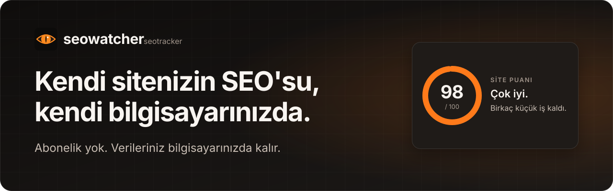
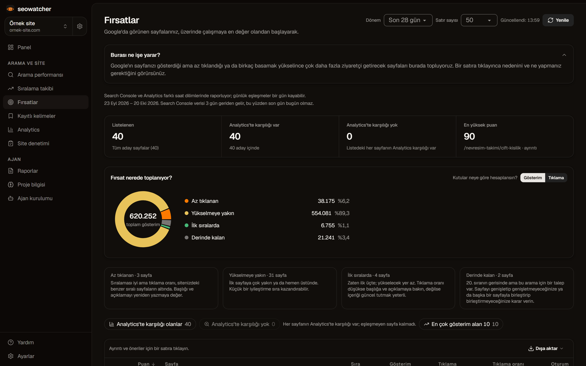
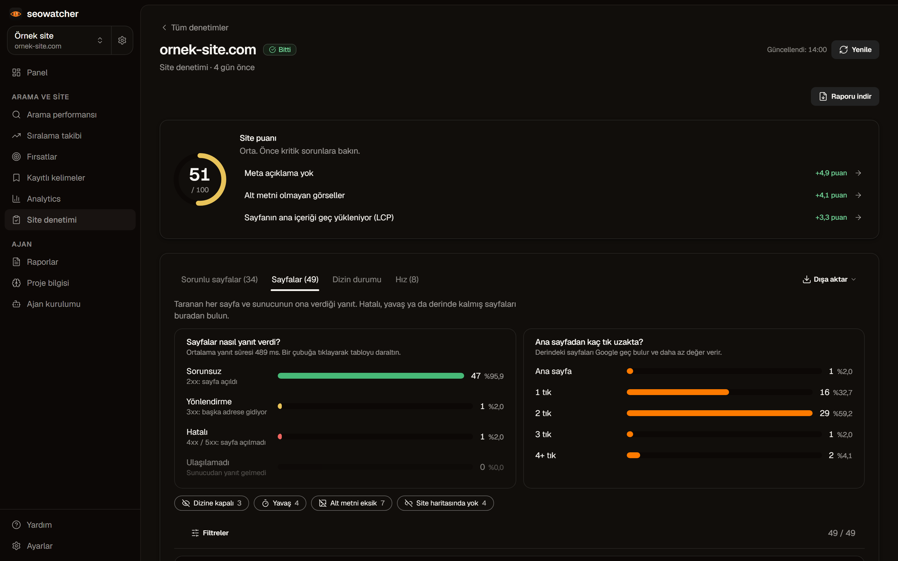
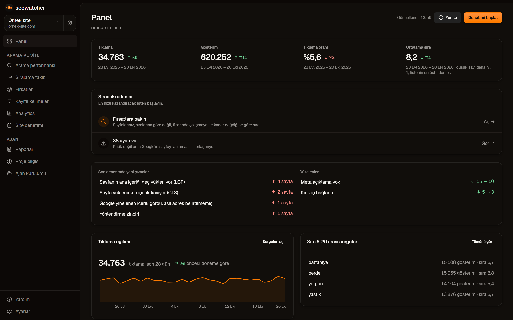
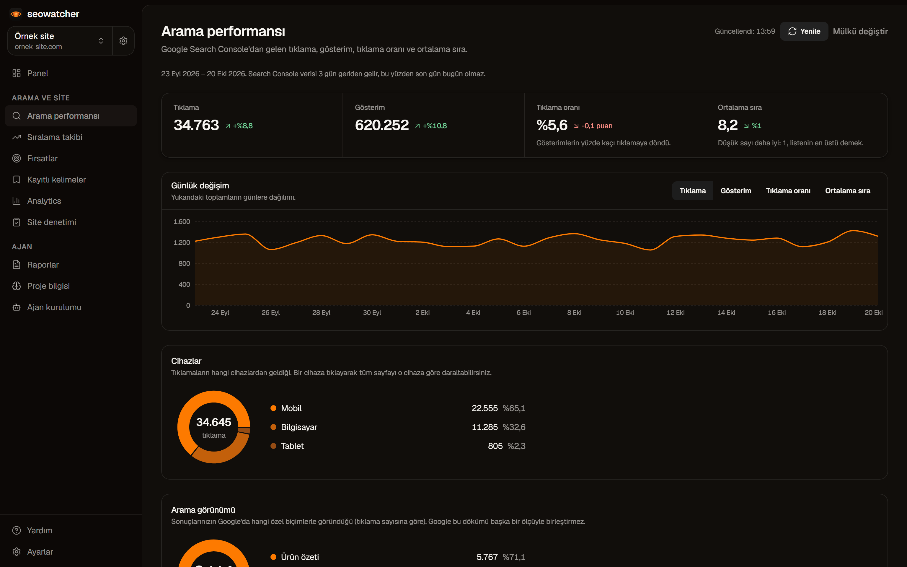
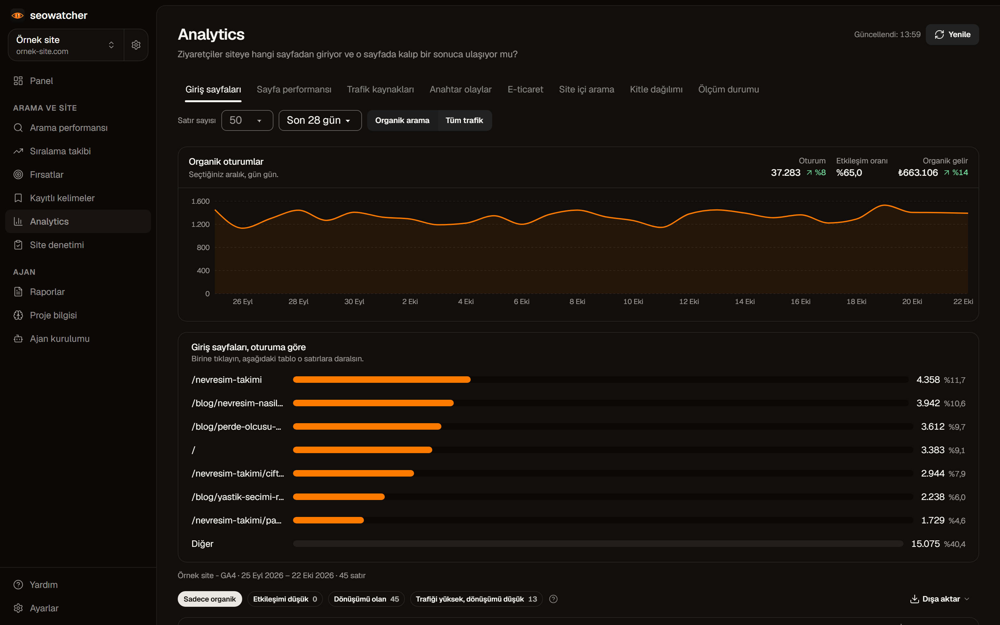
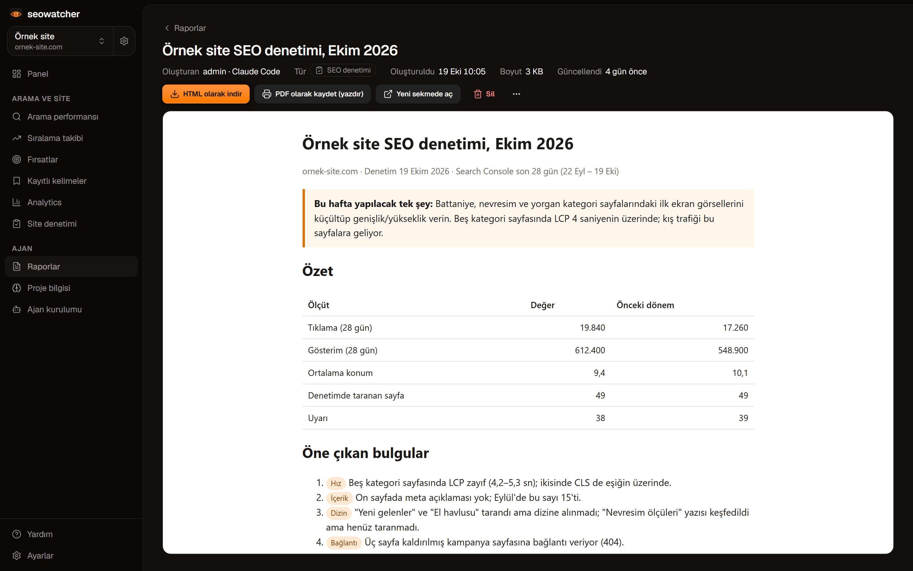
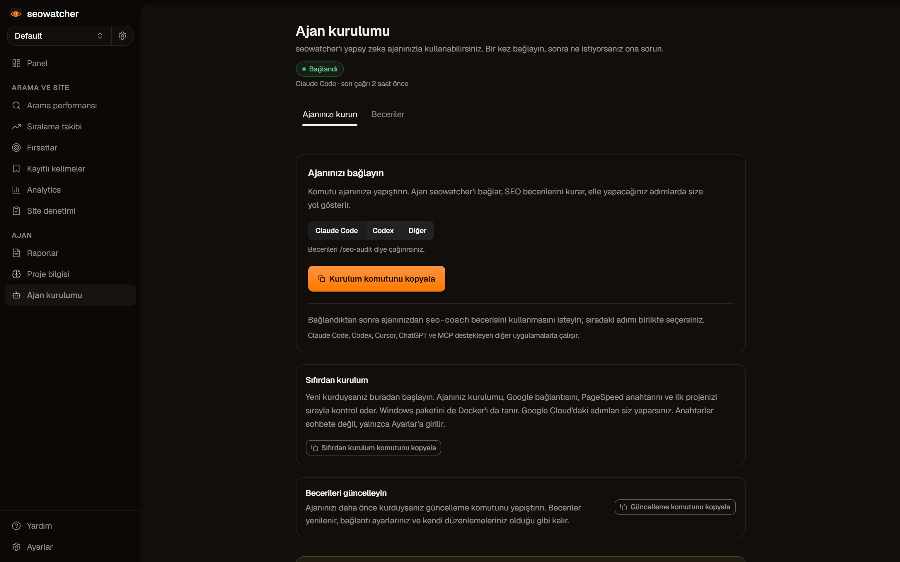
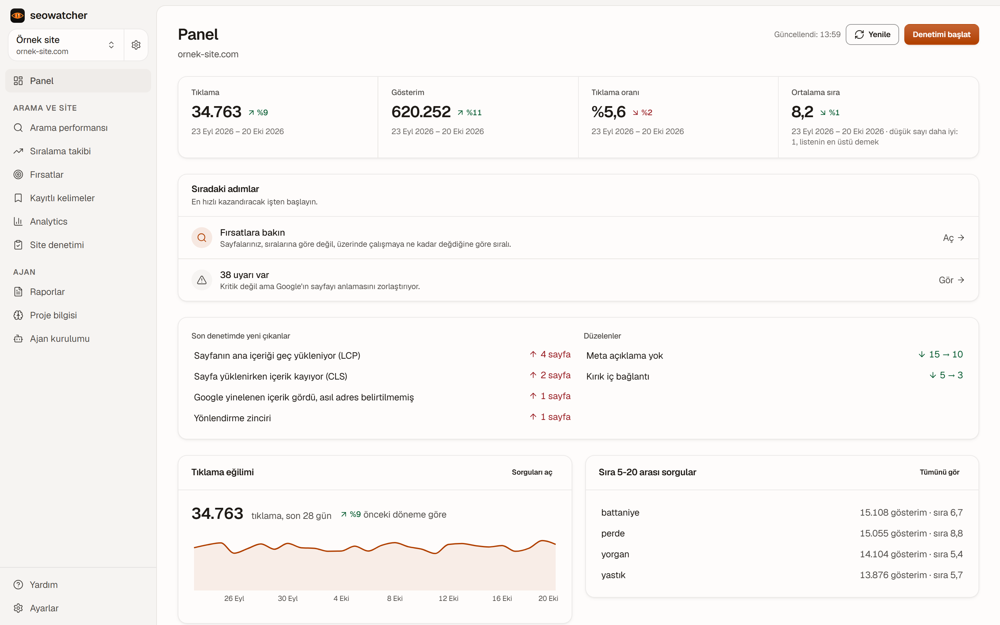
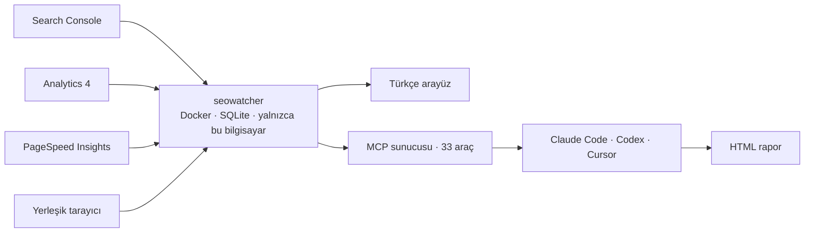

<p align="center">
  
</p>

<p align="center">
  <b>Sitenizin Google verisini kendi bilgisayarınızda izleyin. Ücretsiz, hesapsız, Türkçe.</b>
</p>

<p align="center"><sub>Ürünün adı <b>seowatcher</b>; bu GitHub deposunun adı <code>seotracker</code>.</sub></p>

<p align="center">
  <a href="./CHANGELOG.md"></a>
  
  
  <a href="./LICENSE"></a>
</p>

<p align="center">
  <a href="#neden">✨ Neden</a> ·
  <a href="#kurulum">🚀 Kurulum</a> ·
  <a href="#ekranlar">🖼️ Ekranlar</a> ·
  <a href="#neler-yapar">🧭 Neler yapar</a> ·
  <a href="#yapay-zeka">🤖 Yapay zeka</a> ·
  <a href="#sss">❓ SSS</a> ·
  <a href="#belgeler">📚 Belgeler</a>
</p>

---

<a id="neden"></a>

## ✨ Neden seowatcher?

<table>
  <tr>
    <td width="33%" valign="top">
      <h3>🔒 Veriniz sizde kalır</h3>
      Docker ile kendi bilgisayarınızda çalışır ve yalnızca bu bilgisayardan erişilir. Her şey tek bir SQLite dosyasında durur. Dışarıya yalnızca Google'a yaptığınız bağlantı ve günde bir sürüm kontrolü gider; ikisini de siz yönetirsiniz.
    </td>
    <td width="33%" valign="top">
      <h3>🆓 seowatcher için abonelik yok</h3>
      Google'ın size zaten ücretsiz verdiği veriyi kullanır: Search Console, Analytics 4, PageSpeed Insights. Satın alınan hiçbir veri yok.
    </td>
    <td width="33%" valign="top">
      <h3>🤖 Ajanınızla çalışır</h3>
      Claude Code, Codex, Cursor gibi ajanlar aynı veriye MCP üzerinden ulaşır; rapor yazar, denetim başlatır, düşüşü teşhis eder.
    </td>
  </tr>
</table>

> **Nereden geliyor?** [every-app/open-seo](https://github.com/every-app/open-seo) projesinden türetilmiştir. Özgün proje ücretli bir veri sağlayıcısına (DataForSEO) dayanıyordu; bu sürüm o bağımlılığı ve onunla gelen çok kullanıcılı altyapıyı tamamen kaldırır, arayüzü Türkçeleştirir.

---

<a id="kurulum"></a>

## 🚀 Kurulum

### 🪟 Windows: tek kurulum dosyası

Docker, Node ya da terminal gerekmez. [**seowatcher-setup.exe**](https://github.com/ucsahinn/seotracker/releases/latest/download/seowatcher-setup.exe) dosyasını indirip çalıştırın: uygulama kullanıcı klasörünüze kurulur, veritabanı hazırlanır, tarayıcıda **http://127.0.0.1:3001** açılır. Görev çubuğundaki simgeden açılır, yeniden başlar, kapanır; "Windows ile başlat" seçeneği kurulumda sorulur. Veriniz `%LOCALAPPDATA%\seowatcher` altında durur, kaldırma ona dokunmaz. Kurulum dosyası henüz kod imzalı değil: SmartScreen uyarısında **Daha fazla bilgi → Yine de çalıştır** deyin. Paket, uygulamanın motorunun ihtiyaç duyduğu Microsoft Visual C++ çalışma zamanını da taşır ve eksikse kurar; görev çubuğundaki simge yeni sürümü kendiliğinden indirip doğrulayıp kurar (menüden kapatılabilir), **Kurulumu onar** ve **Sorunu bildir** ile takılan kurulumu toparlar. Paketin nasıl üretildiği: [`packaging/windows/`](packaging/windows/README.md).

Site: [seowatcher.io](https://seowatcher.io) (Türkçe), [seowatcher.io/en/](https://seowatcher.io/en/) (English).

### 🐳 Docker (Mac, Linux, Windows)

**Gerekenler:** Docker Desktop (Windows'ta WSL 2 ve sanallaştırma açık olmalı), bir Google hesabı ve depoyu indirmek için Git. Git yoksa GitHub'daki **Code → Download ZIP** de olur.

```sh
git clone https://github.com/ucsahinn/seotracker.git
cd seotracker
docker compose up -d
```

Docker çalışır, veritabanı ve şifreleme anahtarı kendiliğinden hazırlanır. İlk açılış birkaç dakika sürer; sonra **http://localhost:3001** adresini açın. Google'a bağlanmak için aşağıdaki iki adım gerekir.

### ⚡ Google'a bağlayın

| Adım         | Ne yapacaksınız                                                                                                                                                                                                                                                               |
| :----------- | ----------------------------------------------------------------------------------------------------------------------------------------------------------------------------------------------------------------------------------------------------------------------------- |
| 1️⃣           | Google Cloud'da bir OAuth istemcisi oluşturup **Ayarlar → Google bağlantısı**'na girin. Search Console ve Analytics aynı istemciyi kullanır. Adım adım: [Search Console](./docs/SELF_HOSTING_GOOGLE_SEARCH_CONSOLE.md) · [Analytics](./docs/SELF_HOSTING_GOOGLE_ANALYTICS.md) |
| 2️⃣           | Projenizi oluşturun ve Search Console mülkünüzü seçin. Veri ilk açılışta gelir.                                                                                                                                                                                               |
| İsteğe bağlı | Ücretsiz bir PageSpeed Insights anahtarını **Ayarlar → Hız ölçümü**'ne yapıştırın. Anahtarsız hız ölçümü ilk 50 sayfayla sınırlı kalır. [Nasıl alınır](./docs/PAGESPEED_API_KEY.md)                                                                                           |

Bu adımları elle yapabilirsiniz; bir ajan şart değil. Ajanınız varsa **Ajan kurulumu** sayfasındaki **Kurulum istemi**ni kopyalayıp yapıştırın: adımları sırayla doğrular ve elle yapmanız gerekenleri söyler.

> 🔑 Anahtarları yalnızca uygulamanın **Ayarlar** ekranına girersiniz, sohbete değil.

### 🔄 Güncelleme

```sh
git pull
docker compose up -d --build
```

Veritabanınız ve şifreleme anahtarınız Docker'ın veri alanında (`seotracker_data`) durur; güncelleme onu silmez, veritabanı güncellemeleri açılışta kendiliğinden uygulanır. **Ayarlar → Hakkında** günde bir kez GitHub'a bakıp yeni sürüm var mı söyler; isterseniz oradan kapatın. Windows paketi güncellemeyi kendisi yapar: günde bir kez GitHub'a bakar, yeni sürümü indirir, SHA-256 ile doğrular ve sessizce kurar.

---

<a id="ekranlar"></a>

## 🖼️ Ekranlar

Karanlık ve aydınlık tema, tek tıkla değişir. Görüntüler gerçek bir kurulumdan alınmıştır; küçük görsele tıklayınca tam boyu açılır.

<a href="./docs/images/screenshots/firsatlar-dark.png"></a>

<table>
  <tr>
    <td width="50%"><a href="./docs/images/screenshots/site-denetimi-detay-dark.png"></a><br><sub>🧰 <b>Site denetimi.</b> Site puanı, en çok sayfayı etkileyen sorunlar ve önem dağılımı.</sub></td>
    <td width="50%"><a href="./docs/images/screenshots/panel-dark.png"></a><br><sub>🏠 <b>Panel.</b> Dört ana sayı, sıradaki adımlar, son denetimde düzelenler.</sub></td>
  </tr>
  <tr>
    <td width="50%"><a href="./docs/images/screenshots/arama-performansi-dark.png"></a><br><sub>🔎 <b>Arama performansı.</b> Günlük değişim, cihazlar, ülkeler ve sıra 5-20 arası sorgular.</sub></td>
    <td width="50%"><a href="./docs/images/screenshots/analytics-dark.png"></a><br><sub>📊 <b>Analytics.</b> Organik oturumlar, giriş sayfaları, dönüşümler ve ölçüm durumu.</sub></td>
  </tr>
  <tr>
    <td width="50%"><a href="./docs/images/screenshots/rapor-ornek-dark.png"></a><br><sub>📄 <b>Rapor.</b> Ajanın yazdığı tek sayfalık HTML belge: puan, özet ve bu hafta yapılacak üç şey.</sub></td>
    <td width="50%"><a href="./docs/images/screenshots/ajan-kurulumu-dark.png"></a><br><sub>🤖 <b>Ajan kurulumu.</b> Tek istemi kopyalayın, ajanınız gerisini halletsin.</sub></td>
  </tr>
</table>

<details>
<summary>☀️ Aydınlık temada nasıl görünüyor?</summary>
<p align="center">
  <a href="./docs/images/screenshots/panel-light.png"></a>
</p>
</details>

---

<a id="neler-yapar"></a>

## 🧭 Neler yapar

|     | Özellik                        | Size ne verir                                                                                                                                                                                    |
| --- | ------------------------------ | ------------------------------------------------------------------------------------------------------------------------------------------------------------------------------------------------ |
| 🔎  | **Search Console performansı** | Tıklama, gösterim, tıklama oranı ve ortalama sıra. **Sıra 5-20 arası sorgular** ayrı listelenir: ikinci sayfanın başında kalmış, küçük bir iyileştirmeyle yükselebilecek sorgular.               |
| 📈  | **Sıralama takibi**            | Google veriyi 16 ay sonra siliyor; seowatcher günlük kayıtları yerelde tutar. Sayfa her açılışta eksik günleri kendiliğinden tamamlar.                                                           |
| 🧰  | **Site denetimi**              | Yerleşik tarayıcı sitenizi gezer ve **95 teknik SEO kuralını** (10 kritik, 48 uyarı, 37 bilgi) denetler: kırık bağlantı, eksik başlık, yinelenen içerik, hiçbir sayfadan bağlantı almayan sayfa. |
| ⚡  | **Hız skorları**               | Denetimde her sayfanın mobil ve masaüstü performans, erişilebilirlik ve SEO puanı (PageSpeed Insights). Yanında gerçek Chrome kullanıcılarından gelen Çekirdek Web Verileri.                     |
| 🗂️  | **İndeksleme durumu**          | Google bu sayfayı gerçekten dizine aldı mı? URL Inspection API cevaplar. Tarayıcı "girebilir" der, bu "girdi" der.                                                                               |
| ⚔️  | **Çakışan sorgular**           | Aynı sorgu için kendi sayfalarınızın birbiriyle yarıştığı yerler. Search Console bunu göstermez; seowatcher sorgu ve sayfayı birlikte gruplar.                                                   |
| 🎯  | **Fırsatlar**                  | Sayfalarınızı dört gruba ayırır: az tıklanan, yükselmeye yakın, ilk sıralarda, derinde kalan. Analytics bağlıysa hangi sayfanın para kazandırdığını da bilir.                                    |
| 📊  | **Google Analytics 4**         | Organik trafik, giriş sayfaları, dönüşümler, kitle dağılımı, site içi arama, e-ticaret. Ölçüm durumu, gerçek düşüşü takip kopukluğundan ayırır.                                                  |
| 🔁  | **Denetim karşılaştırması**    | Bir haftadır tarama yoksa panel hatırlatır; son iki denetimi karşılaştırıp yeni çıkan sorunları ayrı gösterir.                                                                                   |
| 📄  | **Raporlar**                   | Ajanın yazdığı, tek dosyalık HTML belgeler. Şablon kaydedin, aynı raporu her ay isteyin.                                                                                                         |
| 🧠  | **Proje bilgisi**              | İşiniz, hedefiniz, kilit sayfalar, rakipler ve araştırma günlüğü tek yerde. Ajan her oturuma bu bağlamla başlar.                                                                                 |
| 🤖  | **MCP sunucusu**               | Ajanlar bu verinin tamamına 33 araç üzerinden erişir. Bağlantı için [`docs/SELF_HOSTING_DOCKER.md`](./docs/SELF_HOSTING_DOCKER.md#mcp-kimlik-doğrulaması).                                       |

### 🚫 Ne yapmaz

Rakip analizi, anahtar kelime hacmi, backlink profili ve üçüncü taraf sıralama takibi **yoktur**. Bunların hepsi satın alınan veriye dayanıyordu ve geri gelmeyecek. seowatcher, Search Console'un zaten bildiği şeyin üzerine kurulur.

### 🔄 Nasıl çalışır



Kota harcayan çağrılar (URL denetimi, PageSpeed) yalnızca siz düğmeye bastığınızda yapılır ve sonuçlar saklanır.

---

<a id="yapay-zeka"></a>

## 🤖 Yapay zeka ajanıyla kullanın

Raporları, denetimleri ve düşüş incelemelerini bir yapay zeka ajanına yaptırabilirsiniz. **Ajan kurulumu** sayfasındaki istemi kopyalayıp Claude Code, Codex veya Cursor'a yapıştırın; ajan MCP bağlantısını kurar ve hazır SEO becerilerini yükler.

### 🎓 Hazır beceriler

| Beceri              | Ne zaman kullanılır                                                                                               |
| ------------------- | ----------------------------------------------------------------------------------------------------------------- |
| `seo-coach`         | "Nereden başlayayım?" Akışları anlatır, sıradaki adımı önerir.                                                    |
| `seo-project-setup` | Projenin bağlamını doldurur: site kapsamı, hedefler, rakipler, kilit sayfalar.                                    |
| `seo-audit`         | Siteyi denetler, **bu hafta yapılacak tek işe** odaklanan tek sayfalık sade bir rapor çıkarır.                    |
| `seo-triage`        | Trafik düştü mü? Önce gerçek mi, nerede ve ne zaman oldu diye bakar; hiçbir şeyi değiştirmeden teşhis koyar.      |
| `seo-check-in`      | Bu dönemi öncekiyle karşılaştırır, ne değişti ve önemli mi diye söyler; rapor olarak kaydeder, seri tarihçe olur. |
| `seo-report`        | Araştırmanın sonunu tek bir HTML sayfasına dönüştürür ve kaydeder.                                                |

### 🧩 MCP araçları

<details>
<summary>33 aracın tam listesi</summary>

| Alan           | Araçlar                                                                                                                                                                                                                                                                                                                                                                                       |
| -------------- | --------------------------------------------------------------------------------------------------------------------------------------------------------------------------------------------------------------------------------------------------------------------------------------------------------------------------------------------------------------------------------------------- |
| Başlangıç      | `whoami` · `list_projects` · `create_project` · `get_diagnostics` · `get_project_context` · `update_project_context`                                                                                                                                                                                                                                                                          |
| Search Console | `get_search_console_performance` · `get_search_opportunities` · `get_cannibalization` · `get_ranking_history` · `get_index_coverage` · `inspect_urls` · `get_sitemaps`                                                                                                                                                                                                                        |
| Analytics 4    | `get_google_analytics_organic_overview` · `get_google_analytics_organic_landing_pages` · `get_google_analytics_traffic_acquisition` · `get_google_analytics_page_performance` · `get_google_analytics_key_events` · `get_google_analytics_audience_breakdown` · `get_google_analytics_site_search` · `get_google_analytics_ecommerce_performance` · `get_google_analytics_measurement_health` |
| Denetim        | `run_site_audit` · `get_audit_status` · `get_audit_issues` · `get_audit_pages`                                                                                                                                                                                                                                                                                                                |
| Kayıtlı iş     | `save_keywords` · `list_saved_keywords` · `save_report` · `get_report` · `list_reports` · `save_report_template` · `list_report_templates`                                                                                                                                                                                                                                                    |

Araç açıklamaları İngilizcedir; ajanlar okur. Ajan, sayfa metinlerinin ya da sorguların içine gömülü komutlara uymaz; yalnızca sizin isteklerinizi yapar. Yazan araçlar (kelime kaydetme, bağlam güncelleme, URL denetimi) çağrıldığı anda çalışır; sizden onay istemek ajanın işidir.

</details>

---

<a id="sss"></a>

## ❓ Sıkça sorulanlar

<details>
<summary><b>Açılmıyor, ne yapayım?</b></summary>

**Windows paketi:** görev çubuğundaki seowatcher simgesine bakın; üzerine gelince "Çalışıyor: http://127.0.0.1:3001/" yazmalı. Simge yoksa Başlat menüsünden açın. "Hata" yazıyorsa sağ tıklayıp **Yeniden başlat**, olmazsa **Kurulumu onar** deyin; **Günlükleri aç** ile `launcher.log` ve `server.log` nedeni yazar, **Sorunu bildir (GitHub)** bunları hazır bir kayda koyar.

**Docker:**

- Docker Desktop çalışıyor mu? Windows'ta tepsideki Docker simgesi "running" göstermeli.
- `docker compose ps` çalıştırın ve durum **healthy** olana kadar bekleyin; ilk açılış birkaç dakika sürebilir.
- Hâlâ açılmıyorsa son günlük satırlarına bakın: `docker compose logs --tail 50`

</details>

<details>
<summary><b>3001 numaralı adres (port) dolu</b></summary>

**Windows paketi:** 3001 doluysa uygulama 3002 ile 3010 arasında boş bir numara seçer ve simgenin yazısında gösterir. Belirli bir numara istiyorsanız **Veri klasörünü aç** deyip `config.json` içindeki `"port"` değerini değiştirin, sonra **Yeniden başlat** deyin. Numara değişince Google yönlendirme adreslerini de güncelleyin.

**Docker ("Bind for 127.0.0.1:3001 failed"):** port başka bir program tarafından kullanılıyor. Proje klasöründe `PORT=3002` satırını içeren bir `.env` dosyası oluşturun. Windows'ta Not Defteri dosyayı sessizce `.env.txt` diye kaydedebilir; PowerShell ile oluşturmak güvenlidir:

```powershell
Set-Content -Encoding ascii .env 'PORT=3002'
```

Sonra uygulamayı yeniden oluşturun ve `http://localhost:3002` adresini açın:

```sh
docker compose up -d --force-recreate seotracker
```

Port değişirse Google OAuth yönlendirme adresini de (`http://localhost:3002/api/gsc/oauth/callback`) Google Cloud Console'da güncelleyin.

</details>

<details>
<summary><b>İnternete açabilir miyim?</b></summary>

Uygulama kimlik doğrulaması yapmaz (`AUTH_MODE=local_noauth`) ve yalnızca bu bilgisayardan erişilir. İnternete açacaksanız önüne kendi kimlik doğrulamanızı koyun. Tüm ortam değişkenleri: [`docs/ENVIRONMENT.md`](./docs/ENVIRONMENT.md).

</details>

<details>
<summary><b>Neden anahtar kelime hacmi ya da backlink göremiyorum?</b></summary>

Çünkü o veri ücretli sağlayıcılardan satın alınıyordu ve bu sürüm onları bilerek kaldırdı. Gösterim sayısı, Google'da gerçekten kaç kez görüldüğünüzü gösterir; başlamak için yeter.

</details>

<details>
<summary><b>Google verisi neden 3 gün geriden geliyor?</b></summary>

Search Console verisi yaklaşık 3 gün gecikmeli yayımlanır. Bu yüzden ekranlar ve ajan, karşılaştırmayı yerleşmiş dönemler üzerinden yapar.

</details>

---

<a id="belgeler"></a>

## 📚 Belgeler

| Belge                                                                                   | Konu                                                                     |
| --------------------------------------------------------------------------------------- | ------------------------------------------------------------------------ |
| [`kb/kurulum-windows.md`](./docs/kb/kurulum-windows.md)                                 | Windows paketi: kurulum, güncelleme, onarım, günlükler, kurumsal dağıtım |
| [`CODE_SIGNING.md`](./docs/CODE_SIGNING.md)                                             | Kurulum dosyasını SignPath ile ücretsiz imzalama, SmartScreen, winget    |
| [`SELF_HOSTING_DOCKER.md`](./docs/SELF_HOSTING_DOCKER.md)                               | Docker ile kurulum, veri alanı, MCP kimlik doğrulaması                   |
| [`SELF_HOSTING_GOOGLE_SEARCH_CONSOLE.md`](./docs/SELF_HOSTING_GOOGLE_SEARCH_CONSOLE.md) | Google Cloud projesi ve OAuth istemcisi                                  |
| [`SELF_HOSTING_GOOGLE_ANALYTICS.md`](./docs/SELF_HOSTING_GOOGLE_ANALYTICS.md)           | Analytics 4 bağlantısı                                                   |
| [`PAGESPEED_API_KEY.md`](./docs/PAGESPEED_API_KEY.md)                                   | Ücretsiz PageSpeed anahtarı                                              |
| [`ENVIRONMENT.md`](./docs/ENVIRONMENT.md)                                               | İsteğe bağlı ortam değişkenleri                                          |
| [`LOCAL_DEVELOPMENT.md`](./docs/LOCAL_DEVELOPMENT.md)                                   | Geliştirme ortamı                                                        |
| [`CHANGELOG.md`](./CHANGELOG.md)                                                        | Sürüm notları                                                            |
| [`specs/`](./specs)                                                                     | Tasarım kayıtları: ne, nasıl, hangi alternatif neden kaybetti            |

---

## 🛠️ Geliştirme

Yerel geliştirme için [`docs/LOCAL_DEVELOPMENT.md`](./docs/LOCAL_DEVELOPMENT.md). Çalışan bir kurulumu uçtan uca sınamak için:

```sh
pnpm run verify:local            # http://localhost:3001
pnpm run verify:local http://127.0.0.1:3002
```

Betik sağlık kontrolünü, MCP araç listesini ve gerçek bir site denetimini sırayla çalıştırır; birim testlerinin kaçırdığı şeyleri yakalar. Göndermeden önce `pnpm run ci:check` ve `pnpm test` yeşil olmalı.

**Yığın:** TanStack Start + Router + Query · React · Tailwind + daisyUI · Drizzle + SQLite (D1) · Cloudflare Workers çalışma zamanı · Vitest.

## 📜 Lisans

MIT. Telif hakkı özgün proje için Ben Senescu'ya aittir; lisans metni [`LICENSE`](./LICENSE) dosyasında korunmuştur.

<p align="center"><sub>Yayında tek sürüm tutulur; güncel sürüm ve notlar <a href="./CHANGELOG.md">CHANGELOG.md</a>'de. <code>v0.0.1</code> – <code>v0.1.9</code> open-seo'nun etiketleriydi ve kaldırıldı.</sub></p>
